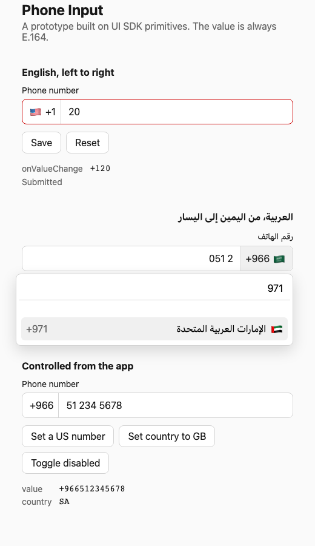

# Phone Input prototype

A phone number field built on [UI SDK](https://github.com/vercel-labs/ui) primitives. It is unstyled, its value is always E.164, and it reads correctly on right-to-left pages.



This is a prototype to back a component proposal upstream. It uses only UI SDK's public API (`definePrimitive`, `createChange`, `usePart`, `usePrimitive`) and its Combobox, pinned to `0.1.0-beta.10`.

## Run it

```bash
pnpm install
pnpm dev            # demo at http://localhost:5199, English and Arabic forms
pnpm test           # unit tests for the editing logic
pnpm test:browser   # real-browser checks; needs `pnpm dev` running
pnpm typecheck
```

`pnpm test:browser` uses Playwright 1.64.1. Run `npx playwright install chromium` once if its browser isn't on your machine.

## Use it

```tsx
<PhoneInput name="phone" required engine={engine} defaultCountry="SA">
  <PhoneInputCountry itemToLabel={(country) => names.get(country) ?? country}>
    {(state) => (
      <>
        <ComboboxTrigger aria-label="Country">
          <span aria-hidden="true">{state.flag}</span>
          <PhoneInputDialCode />
        </ComboboxTrigger>
        <ComboboxContent>
          <ComboboxInput autoFocus aria-label="Search countries" />
          <ComboboxList>
            {options.map((option) => (
              <ComboboxItem
                key={option.value}
                value={option.value}
                label={option.label}
                keywords={option.keywords}
              >
                {option.label}
              </ComboboxItem>
            ))}
          </ComboboxList>
        </ComboboxContent>
      </>
    )}
  </PhoneInputCountry>
  <PhoneInputField />
</PhoneInput>
```

`PhoneInputCountry` is a UI SDK Combobox whose value is the country, so every Combobox part and prop works inside it. `countryOptions(engine, locale)` builds `options`, with names from the browser's `Intl.DisplayNames`.

## What it does

- **E.164 value.** `onValueChange` and the submitted form field always carry `+966512345678`, whatever the field shows.
- **Formats as you type.** The caret keeps its place among the digits. Backspace over a separator deletes the digit beside it.
- **Follows a typed calling code.** Typing or pasting `+44…` selects the United Kingdom.
- **Right-to-left safe.** The field and the dial code stay left to right, so a number never shows as `5678 234 051` or `966+`.
- **Reads Arabic-Indic and Persian digits.** `٠٥١٢` becomes `0512`.
- **Loads its data late.** The engine is an option. Until it arrives, the field keeps plain digits. In the demo build the engine is a separate 36 KB gzipped chunk.
- **Works in a native form.** `name`, `required`, `disabled`, `readOnly`, reset, and the browser's own validation message.

## Layout

| Path | What it holds |
| --- | --- |
| `src/engine.ts` | The `PhoneEngine` interface, digit reading, country options |
| `src/edit.ts` | Formatting an edit and placing the caret. Pure, no DOM |
| `src/phone-input.ts` | The primitive, with no framework code |
| `src/engines/libphonenumber.ts` | An engine backed by libphonenumber-js |
| `src/react/phone-input.tsx` | The React parts |
| `demo/` | The demo, plus `repro.html` for an upstream Combobox bug |

## Known gaps

- Only the React parts exist. The primitive is framework-free, but the Vue, Svelte, Solid and Web Components parts aren't written.
- The field's text is written when it mounts, so server-rendered HTML has an empty field until hydration.
- No test with a screen reader yet, and none in Safari or Firefox.
- `readOnly` and the Vue-style callback kinds are untested.
- A controlled `value` the app refuses to update leaves the typed text in the field.

## License

MIT
